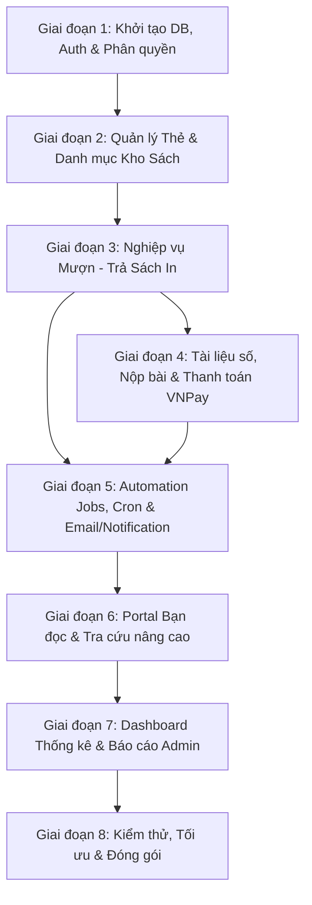

# 📋 LỘ TRÌNH TRIỂN KHAI & CHECKLIST CHỨC NĂNG HỆ THỐNG THƯ VIỆN / THUÊ SÁCH

> **Hướng dẫn sử dụng:**
>
> - File này được sắp xếp theo **thứ tự ưu tiên triển khai thực tế** (từ nền tảng hệ thống, nghiệp vụ cốt lõi đến các tính năng mở rộng và báo cáo).
> - Khi hoàn thành bất kỳ chức năng nào, hãy tích vào ô `[ ]` tương ứng thành `[x]`.

---

## 📅 TỔNG QUAN CÁC GIAI ĐOẠN TRIỂN KHAI (ROADMAP)

---

## 🚀 GIAI ĐOẠN 1: CƠ SỞ DỮ LIỆU, XÁC THỰC & PHÂN QUYỀN (CORE FOUNDATION)

_Ưu tiên: Bắt buộc làm đầu tiên để xây dựng nền móng dữ liệu và phân quyền._

### 1.1. Thiết kế Cơ sở dữ liệu & Cấu hình hệ thống

- [x] Thiết kế ERD & Schema Database (Chuyển đổi hoàn toàn sang **MySQL** + Sequelize ORM)
- [x] Cấu hình hệ thống lưu trữ File/Media (Ảnh bìa, Ảnh đại diện, File PDF tài liệu)
- [x] Cấu hình môi trường bảo mật (JWT Secret, API Key, Mail Server, Payment Gateway Sandbox)

### 1.2. Phân quyền người dùng (RBAC)

- [x] Phân quyền Role: `Superadmin`
- [x] Phân quyền Role: `Admin` (Quản trị viên)
- [x] Phân quyền Role: `Librarian` (Thủ thư)
- [x] Phân quyền Role: `User` (Bạn đọc / Sinh viên / Khách vãng lai)
- [x] Middleware kiểm tra quyền và bảo vệ Endpoint API (`authAdmin`, `authUser`)

### 1.3. Tài khoản & Xác thực (Auth)

- [x] Đăng ký tài khoản
- [x] Xác thực OTP qua email
- [x] Đăng nhập (Email/Mã số thẻ + Mật khẩu)
- [x] Quản lý phiên đăng nhập / Token (JWT Access/Refresh token)
- [x] Đăng xuất & Thu hồi token
- [x] Quên mật khẩu
- [x] Đặt lại mật khẩu (qua OTP/Token email)
- [x] Đổi mật khẩu
- [x] Khóa / Mở khóa tài khoản người dùng

### 1.4. Quản lý Người dùng (Admin)

- [x] Xem danh sách người dùng
- [x] Tìm kiếm & Lọc người dùng (theo role, trạng thái)
- [x] Thêm người dùng mới thủ công
- [x] Chỉnh sửa thông tin người dùng
- [x] Xóa / Khôi phục tài khoản
- [x] Cấp lại mật khẩu cho người dùng
- [x] Export danh sách tài khoản ra file Excel

---

## 📚 GIAI ĐOẠN 2: QUẢN LÝ DANH MỤC, KHO SÁCH & THẺ THƯ VIỆN

_Ưu tiên: Xây dựng kho dữ liệu sách và hệ thống định danh thẻ bạn đọc._

### 2.1. Quản lý Thẻ thư viện (User & Admin)

- [x] **Bạn đọc:** Đăng ký thẻ trực tuyến (nhập thông tin, upload ảnh 3x4, chọn loại thẻ)
- [x] **Bạn đọc vãng lai:** Đăng ký thẻ khách (điền form, upload ảnh)
- [x] **Bạn đọc:** Hủy yêu cầu đăng ký thẻ
- [x] **Bạn đọc:** Theo dõi trạng thái thẻ (Chờ duyệt, Đã duyệt, Từ chối, Đang hoạt động, Hết hạn, Bị khóa, Bị thu hồi)
- [x] **Admin:** Xem danh sách & Tìm kiếm thẻ bạn đọc
- [x] **Admin:** Duyệt / Từ chối hồ sơ đăng ký thẻ (kèm lý do)
- [x] **Admin:** Cấp mã thẻ & Cấp hạn sử dụng thẻ
- [x] **Admin:** Chỉnh sửa thông tin thẻ / Cập nhật ảnh thẻ
- [x] **Admin:** Khóa thẻ / Mở khóa thẻ / Thu hồi thẻ
- [x] **Admin:** Import / Export danh sách thẻ bằng Excel

### 2.2. Danh mục & Thông tin Sách in

- [x] Quản lý Danh mục sách (Thêm, Sửa, Xóa, Ẩn/Hiện)
- [x] Quản lý Chuyên ngành & Bộ sưu tập
- [x] Quản lý Tác giả (Thêm, Sửa, Xóa, Tìm kiếm)
- [x] Quản lý Nhà xuất bản (Thêm, Sửa, Xóa, Tìm kiếm)
- [x] Quản lý Đầu sách (Tên, ISBN, Tác giả, NXB, Năm XB, Thể loại, Mô tả, Mã phân loại, Số lượng)
- [x] Upload ảnh bìa sách
- [x] Import thông tin sách từ file Excel
- [x] Export thông tin sách ra file Excel
- [x] Ẩn / Hiện sách trên hệ thống tra cứu

### 2.3. Quản lý Kho & Bản sao vật lý (Mã ĐKCB)

- [x] Quản lý bảng phân loại (DDC, UDC, Mã phân loại, Tên phân loại)
- [x] Quản lý Kho (Thêm, Sửa, Xóa/Ẩn kho, Quản lý vị trí kho)
- [x] Quản lý Tủ / Kệ sách (Thêm tủ/kệ, Sửa, Xóa, Xác định vị trí sách)
- [x] **Quản lý Bản sao vật lý (Item Level):** Cấp mã Đăng ký cá biệt (ĐKCB) cho từng cuốn sách
- [x] Gán vị trí kho, tủ/kệ cho từng mã ĐKCB
- [x] Quản lý tình trạng vật lý của sách (Mới, Cũ, Hỏng, Mất)
- [x] Quản lý trạng thái mượn của từng bản sách (Sẵn sàng, Đang mượn, Đang giữ chỗ, Bảo trì)
- [x] Nghiệp vụ Nhập sách / Xuất sách vào kho
- [x] Điều chuyển sách giữa các kho / kệ
- [x] Nghiệp vụ Kiểm kê sách định kỳ
- [x] Tự động cập nhật số lượng tồn kho theo mã ĐKCB

---

## 🔄 GIAI ĐOẠN 3: NGHIỆP VỤ MƯỢN - TRẢ SÁCH IN (CORE BUSINESS LOGIC)

_Ưu tiên: Quy trình mượn - trả sách vật lý, tính phạt và xử lý vi phạm._

### 3.1. Cấu hình Chính sách mượn & Phạt

- [x] Cấu hình số ngày mượn tối đa theo từng loại thẻ
- [x] Cấu hình số lượng sách tối đa được mượn cùng lúc
- [x] Cấu hình hình thức mượn: Mượn về nhà vs Đọc tại phòng đọc
- [x] Cấu hình số lần gia hạn tối đa & số ngày gia hạn mỗi lần
- [x] Cấu hình mức phạt quá hạn theo từng ngày
- [x] Cấu hình mức phạt khi làm hỏng sách
- [x] Cấu hình mức phạt khi làm mất sách
- [x] Cấu hình mức phạt theo loại tài liệu đặc biệt
- [x] Cấu hình ngưỡng ngày quá hạn tự động khóa thẻ

### 3.2. Đăng ký mượn sách phía Bạn đọc

- [x] Thêm sách vào giỏ mượn
- [x] Xóa sách khỏi giỏ mượn / Thay đổi số lượng
- [x] Kiểm tra số lượng tồn và tình trạng sách trước khi đặt
- [x] Đăng ký mượn: Chọn hình thức (Mượn về nhà / Đọc tại phòng)
- [x] Chọn ngày hẹn lấy sách & ngày hẹn trả
- [x] Hệ thống kiểm tra điều kiện mượn (Trạng thái thẻ, Hạn mức thẻ, Sách còn trong kho, Có quá hạn không)
- [x] Gửi yêu cầu mượn sách
- [x] Xem danh sách phiếu mượn & Theo dõi trạng thái phiếu mượn (Chờ duyệt, Đã duyệt, Đang mượn, Sắp hết hạn, Quá hạn, Đã trả, Bị từ chối)
- [x] Gửi yêu cầu gia hạn sách đang mượn
- [x] Xem lịch sử mượn / trả sách, danh sách sách từng mượn, tiền phạt phát sinh

### 3.3. Quản lý Mượn - Trả phía Thủ thư / Admin

- [x] Xem danh sách phiếu mượn, Tìm kiếm & Bộ lọc nâng cao
- [x] Xuất danh sách phiếu mượn ra file Excel
- [x] **Xử lý Mượn online:** Tiếp nhận yêu cầu -> Kiểm tra điều kiện -> Duyệt / Từ chối
- [x] Ghi nhận sách đã giao cho bạn đọc (chuyển sang trạng thái "Đang mượn")
- [x] **Xử lý Mượn tại quầy:** Tạo phiếu mượn trực tiếp -> Chọn bạn đọc -> Quét/chọn mã ĐKCB -> Trừ tồn kho -> Xác nhận mượn
- [x] **Xử lý Trả sách:** Tiếp nhận trả -> Quét/chọn mã ĐKCB -> Kiểm tra tình trạng sách
- [x] Hoàn kho sách sau khi trả (cập nhật trạng thái sách về "Sẵn sàng")
- [x] **Ghi nhận tình trạng hư hỏng / mất sách** và tính phí bồi thường
- [x] **Xử lý Quá hạn:** Tự động tính số ngày quá hạn & số tiền phạt tương ứng
- [x] Ghi nhận vi phạm & Khóa thẻ bạn đọc nếu đủ điều kiện vi phạm
- [x] **Xử lý Gia hạn:** Xem yêu cầu gia hạn -> Kiểm tra điều kiện -> Duyệt / Từ chối -> Cập nhật hạn trả mới

---

## 💻 GIAI ĐOẠN 4: TÀI LIỆU SỐ, NỘP ĐỒ ÁN & THANH TOÁN ONLINE

_Ưu tiên: Quản lý tài liệu điện tử, kinh doanh tài liệu số và phê duyệt đề tài sinh viên._

### 4.1. Quản lý Tài liệu số (Thủ thư / Admin)

- [x] Thêm / Sửa / Xóa / Ẩn hiện tài liệu số
- [x] Upload file PDF tài liệu số gốc
- [x] Biên mục & Phân loại tài liệu số
- [x] Quản lý đồ án / luận văn tốt nghiệp
- [x] Thiết lập giá bán tài liệu số (Giá từng tài liệu, Giá mặc định, Trạng thái bật/tắt bán)

### 4.2. Tra cứu & Đọc thử Tài liệu số (Bạn đọc)

- [x] Xem thông tin chi tiết tài liệu số
- [x] Đọc thử trực tuyến (Preview giới hạn tối đa 5 trang đầu đối với Khách vãng lai)
- [x] Kiểm tra quyền sở hữu của người dùng đối với tài liệu

### 4.4. Đơn hàng & Thanh toán Mua Bản Quyền Tài Liệu Số

- [x] Tạo đơn hàng mua bản quyền tài liệu số bằng Ví cọc
- [x] Trừ số dư ví cọc và tự động khởi tạo lịch sử giao dịch mua (`DigitalDocPurchase`)
- [x] Cấp quyền sở hữu bản quyền tài liệu cho tài khoản ngay sau khi thanh toán thành công

### 4.5. Bảo mật & Tải Tài liệu số đã mua

- [x] Đọc online toàn bộ 100% nội dung tài liệu đã mua (Không bị giới hạn 5 trang)
- [x] Tải file PDF bản quyền gốc trực tiếp về máy tính
- [x] Kiểm tra quyền sở hữu tự động (Check Ownership API)

---

## ⚙️ GIAI ĐOẠN 5: AUTOMATION JOBS, CRON định kỳ & THÔNG BÁO

_Ưu tiên: Tự động hóa các tác vụ hệ thống chạy ngầm không cần can thiệp thủ công._

### 5.1. Background Jobs & Cron xử lý nghiệp vụ

- [ ] **Job OTP:** Tạo mã OTP ngẫu nhiên, giới hạn số lần gửi (rate-limit), xử lý hết hạn sau X phút
- [ ] **Cron Nhắc hạn trả:** Chạy định kỳ hàng ngày -> Quét sách sắp hết hạn (trước 1-3 ngày) -> Gửi email & notification nhắc bạn đọc
- [ ] **Cron Xử lý Quá hạn:** Chạy định kỳ hàng ngày -> Phát hiện phiếu mượn quá hạn -> Cập nhật trạng thái "Quá hạn" -> Tự động tính số ngày quá hạn & tiền phạt -> Gửi thông báo vi phạm
- [ ] **Cron Tự động Khóa thẻ:** Quét các thẻ có sách quá hạn > 30 ngày (hoặc tiền phạt vượt mức) -> Tự động khóa thẻ -> Gửi thông báo/email
- [ ] **Cron Hủy đơn hàng số quá hạn:** Quét các đơn hàng tài liệu số ở trạng thái "Chờ thanh toán" quá 3 ngày -> Tự động hủy đơn -> Cập nhật trạng thái
- [ ] **Job Đồng bộ kho sách:** Tự động đồng bộ số sách đang mượn / đã trả / tồn kho và phát hiện sai lệch số liệu

### 5.2. Hệ thống Thông báo (In-App Notification)

- [x] Thông báo kết quả duyệt/từ chối cấp thẻ thư viện
- [x] Thông báo kết quả duyệt/từ chối phiếu mượn sách
- [x] Thông báo kết quả duyệt gia hạn sách
- [x] Thông báo nhắc sắp đến hạn trả sách
- [x] Thông báo sách bị quá hạn & tiền phạt
- [x] Thông báo thanh toán đơn hàng tài liệu số thành công
- [x] Thông báo kết quả phê duyệt đồ án / luận văn nộp

### 5.3. Hệ thống Email giao dịch (Transactional Email)

- [x] Template Email gửi mã OTP đăng ký / quên mật khẩu
- [x] Template Email chào mừng kích hoạt tài khoản
- [x] Template Email thông báo duyệt thẻ thư viện
- [x] Template Email thông báo duyệt yêu cầu mượn sách (kèm mã phiếu, hạn trả)
- [x] Template Email nhắc trả sách trước hạn
- [x] Template Email cảnh báo sách quá hạn & mức phạt
- [x] Template Email xác nhận thanh toán thành công & hóa đơn tài liệu số
- [x] Template Email thông báo kết quả duyệt tài liệu nộp

---

## 🌐 GIAI ĐOẠN 6: TRANG BẠN ĐỌC (PORTAL), TÌM KIẾM & NỘI DUNG

_Ưu tiên: Giao diện người dùng tra cứu, tìm kiếm và tương tác với thư viện._

### 6.1. Trang Thông tin Thư viện & Quản lý Bài viết

- [x] Trang chủ (Hero banner, Sách mới, Sách nổi bật, Tin tức mới)
- [x] Trang Giới thiệu thư viện
- [x] Trang Lịch phục vụ thư viện
- [x] Trang Hướng dẫn sử dụng & Quy định thư viện, Quy định mượn/trả, Quy định làm thẻ
- [x] Quản lý Tin tức / Thông báo / Sự kiện phía Admin (Thêm, Sửa, Xóa, Lưu nháp, Đăng bài, Upload ảnh)

### 6.2. Tra cứu & Bộ lọc Sách nâng cao

- [x] Thanh tìm kiếm theo: Tên sách, Tác giả, Thể loại, Mã ĐKCB, ISBN, Từ khóa
- [x] Bộ lọc nâng cao: Theo khoa/chuyên ngành, Thể loại, Tình trạng sách, Loại tài liệu, Năm XB, Tác giả, NXB
- [x] Sắp xếp kết quả: Mới nhất, Phổ biến (mượn nhiều), Tên A-Z, Đánh giá sao, Giá cọc
- [x] Trang Chi tiết tài liệu: Thông tin đầy đủ, Ảnh bìa, Tóm tắt, Vị trí kho/kệ, Tình trạng bản sao, Số lượng còn lại, Tài liệu liên quan
- [x] Trang Tìm kiếm chuyên dụng (`/search`) với Chế độ Lưới (Grid) & Danh sách (List)

### 6.3. Quản lý Hồ sơ cá nhân (Bạn đọc)

- [x] Xem thông tin cá nhân & Thông tin thẻ thư viện (`/profile`)
- [x] Chỉnh sửa thông tin cá nhân (Số điện thoại, Địa chỉ, Avatar)
- [x] Đổi mật khẩu tài khoản bảo mật
- [x] Tra cứu Sổ mượn sách in & Lịch sử mua tài liệu số trực tuyến
- [x] Quản lý số dư Ví cọc & Nạp tiền ví trực tiếp

---

## 📊 GIAI ĐOẠN 7: DASHBOARD THỐNG KÊ & BÁO CÁO ADMIN

_Ưu tiên: Công cụ quản trị số liệu, phân tích hoạt động và xuất báo cáo cho lãnh đạo._

### 7.1. Thẻ chỉ số tổng quan (Stat Cards)

- [x] Tổng số bạn đọc
- [x] Tổng số thẻ thư viện (Đang hoạt động / Bị khóa / Hết hạn)
- [x] Tổng số đầu sách & Tổng số bản sao vật lý
- [x] Tổng số tài liệu số
- [x] Số lượng sách đang mượn
- [x] Số lượng sách đang quá hạn
- [x] Tổng số lượt mượn & Tổng số lượt trả
- [x] Tổng doanh thu bán tài liệu số
- [x] Tổng tiền phạt đã thu & chưa thu
- [x] Số lượng đơn hàng tài liệu số
- [x] Số lượng hồ sơ đang chờ duyệt (Thẻ, Mượn sách, Nộp đồ án)

### 7.2. Biểu đồ thống kê & Báo cáo phân tích

- [x] Biểu đồ thống kê lượt mượn - trả theo ngày / tháng / năm
- [x] Biểu đồ tăng trưởng doanh thu tài liệu số theo thời gian
- [x] Biểu đồ thu tiền phạt theo tháng
- [x] Biểu đồ phân bổ bạn đọc & tài liệu theo chuyên ngành/khoa
- [x] Bảng xếp hạng Top sách được mượn nhiều nhất
- [x] Danh sách các đầu sách ít / không được mượn để tối ưu kho
- [x] Xuất báo cáo thống kê tổng hợp định dạng Excel

---

## 🛡️ GIAI ĐOẠN 8: TỐI ƯU HÓA, BẢO MẬT & ĐÓNG GÓI TRIỂN KHAI

_Ưu tiên: Hoàn thiện trước khi đưa vào vận hành chính thức._

- [ ] Kiểm thử toàn diện các luồng nghiệp vụ (Mượn - Trả, Bán tài liệu, Duyệt thẻ, Duyệt bài nộp)
- [ ] Kiểm tra xử lý Concurrency / Race condition (khi 2 người cùng mượn/mua 1 bản sách cuối cùng)
- [ ] Bảo mật phân quyền API (Kiểm tra Authorization, SQL Injection, XSS, Rate Limiting)
- [ ] Bảo vệ file PDF (Ngăn truy cập file trực tiếp nếu chưa mua/chưa đăng nhập)
- [ ] Tối ưu hóa truy vấn Database & Indexing cho chức năng tìm kiếm sách
- [ ] Thiết lập chiến lược Backup dữ liệu định kỳ
- [ ] Hướng dẫn cài đặt & Triển khai hệ thống (Docker, CI/CD, Production Server)

---

> 💡 **Mẹo:** Cập nhật file này thường xuyên sau mỗi Sprint/Task hoàn thành bằng cách đổi `[ ]` thành `[x]`.
